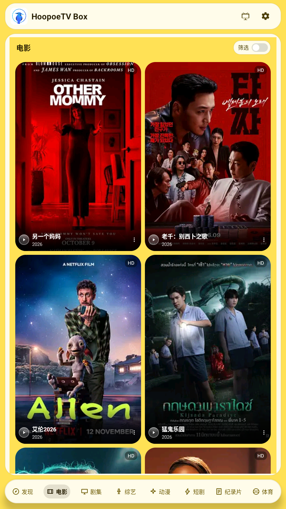
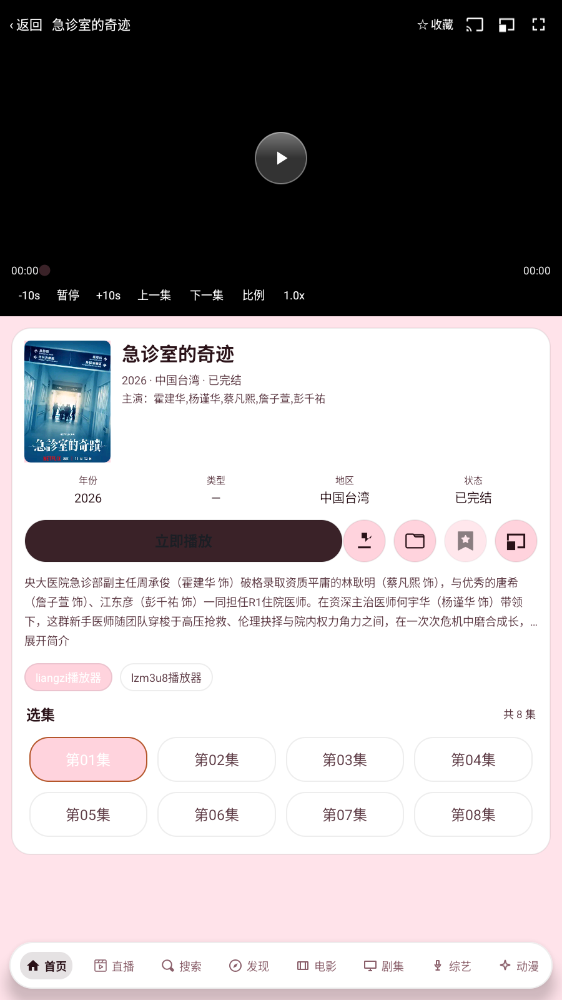
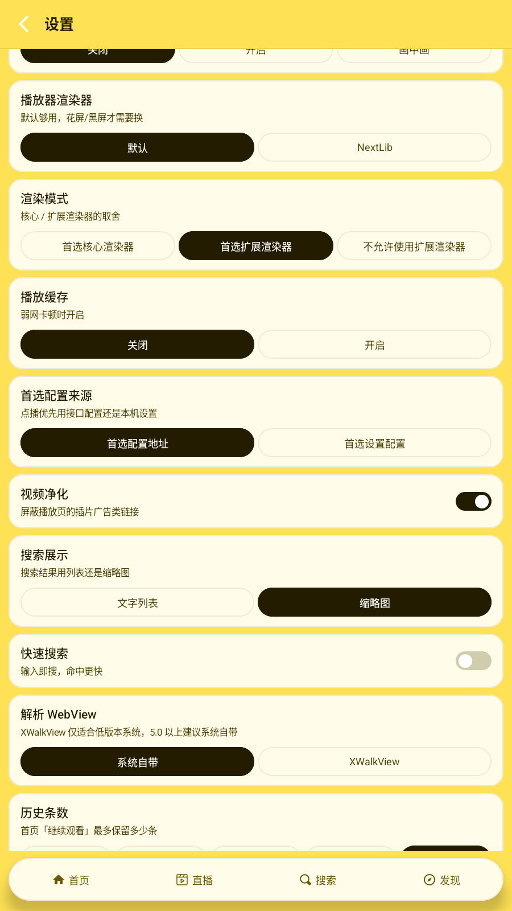
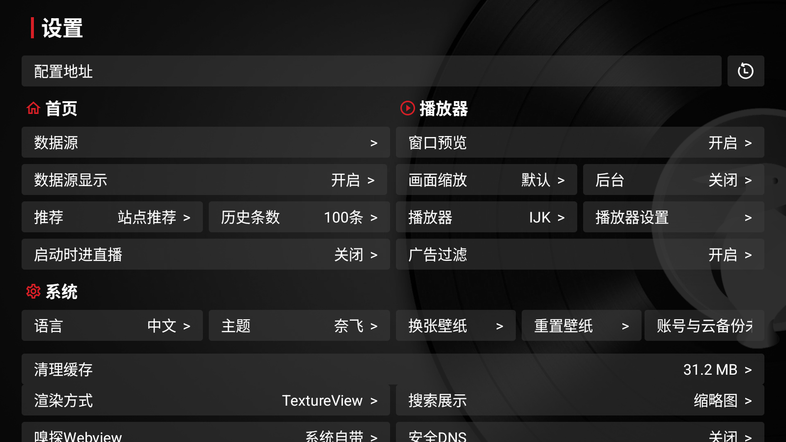
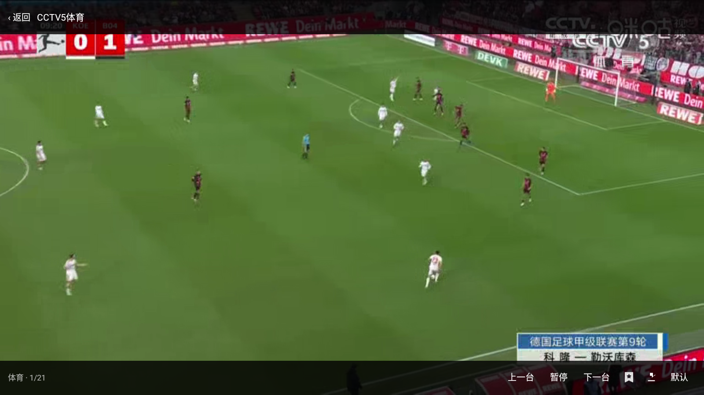

# HoopoeTV

> TVBox 系影视客户端的深度定制版：手机和电视共用同一个 APK，七套主题，出厂是「空壳」——不内置任何源，接哪个源由你决定。


---

## 目录

- [一、项目简介](#一项目简介)
- [二、界面截图](#二界面截图)
- [三、主要特性](#三主要特性)
- [四、包型与命名](#四包型与命名)
- [五、编译](#五编译)
- [六、项目结构](#六项目结构)
- [七、与上游的差异](#七与上游的差异)
- [八、已知限制](#八已知限制)
- [九、免责声明](#九免责声明)

---

## 一、项目简介

HoopoeTV 基于 [takagen99/Box](https://github.com/takagen99/Box)（TVBox 分支）二次开发，在保留 TVBox 完整解析能力的前提下，重做了界面层、播放层与数据层，并把它拆成「手机 / 电视双端」一套代码。

| 项目 | 说明 |
|---|---|
| 包名 | `com.hoopoetv.tvbox`（海信渠道为 `com.hoopoetv.tvbox.hisense`） |
| 当前版本 | `v1.7.30`（versionCode 10121） |
| 运行环境 | Android 5.0+（minSdk 21 / targetSdk 28），`arm64-v8a` / `armeabi-v7a` |
| 语言 | 简体中文 / English |
| 许可 | AGPL-3.0 |

三个和其他 TVBox 分支最不一样的地方：

1. **空壳播放器**：`app_source` / `app_live` / `app_epg` 三个内置地址全部为空，首次启动还会清掉本地残留的源地址。装完打开就是空列表，源地址由使用者自己填。
2. **双端合一**：同一份 APK 里同时装着手机 UI 与电视 UI。默认进手机端，设置页「界面模式」一键切回电视端，不用装两个包。
3. **七套主题**：不是换几张贴图，而是整套语义色板（页面 / 卡片 / 浮层 / 弹窗 / 文字三级 / 按钮 / 描边）一起换。

---

## 二、界面截图

**手机端**

| 首页（樱花粉） | 分类页（小黄黄） | 详情页（樱花粉） |
|:---:|:---:|:---:|
|  |  |  |

| 播放与内核设置（小黄黄） | 电视端设置（奈飞红） | 电视端直播 |
|:---:|:---:|:---:|
|  |  |  |

---

## 三、主要特性

### 3.1 手机端界面

- **卡片化设置页**：每个设置分组一张卡片，开关用胶囊分段按钮，说明文字压在标题下面。
- **底部导航**：首页 / 直播 / 搜索 / 发现 / 电影 / 剧集 / 综艺 / 动漫，点击态跟随主题色。
- **首页「继续观看」**：按播放进度横向排列，右侧可一键清空。
- **详情页胶囊操作区**：立即播放 + 下载 / 文件夹 / 收藏 / 画中画四个圆形按钮，投屏与全屏收在顶栏右侧图标里；选集网格一屏 8 集。
- **播放页手势**：左右滑调进度、上下滑调亮度与音量、快退 / 快进 ±10s、上一集 / 下一集、比例、倍速、画中画、全屏。
- **续播**：退出再进直接落在上次的位置。

### 3.2 电视端界面

- **左侧拨轮导航**：分类从顶部横排改成左侧竖排，固定可视区约 7 项，超出部分由上下拨轮滚动，上下各一层渐变遮罩做淡出。
- **等宽菜单块**：按 6 个汉字宽度定宽，短标签和长标签的块宽完全一致，不会参差。
- **右侧「纸面」内容区**：大圆角 + 淡白底 + 细描边，像一张纸压在主界面上，内容网格 4 列铺满。
- **顶栏六入口**：应用 / 首页 / 直播 / 收藏 / 文件 / 历史 / 推送，等高均分；左上角显示当前源名，点一下就是换源列表。
- **底部分类筛选条**：类型 / 地区 / 排序 / 年代，默认收起，点分类右侧小按钮展开，返回键优先关条。
- **切页过渡**：右侧内容区 alpha + Y 轴位移 260ms 减速入场，左栏同步淡入。
- **返回键优先级**：加载中刷新 → 退出多选 → 关闭筛选条 → 页面越界回退 → 2 秒内按两次退出。

### 3.3 七套主题

| # | 主题 | 主色 | 次色 | 感觉 |
|---|---|---|---|---|
| 0 | 奈飞红 | `#D81F26` | `#F2A03A` | 深色底 + 红，默认主题 |
| 1 | 哆啦蓝 | `#18A2E7` | `#FF6FB5` | 亮蓝配粉，清爽 |
| 2 | 百事深蓝 | `#004B93` | `#3E8BD8` | 深蓝渐变，商务 |
| 3 | 鸣人橙 | `#FF7439` | `#FFC14D` | 高饱和橙黄 |
| 4 | 小黄黄 | `#FFD55E` | `#7A5A16` | 亮底深字，白天友好 |
| 5 | 八神粉 | `#FF2F70` | `#B3204E` | 高对比玫红 |
| 6 | 樱花粉 | `#FD9BDB` | `#9B6BD4` | 浅粉配紫，柔和 |

实现上没有把颜色散进业务代码：`SkinManager` 只负责 `setTheme` + 重建界面，布局统一取 `?attr/skin_accent`、`?attr/skin_bg_page`、`?attr/skin_text_1..3` 这类语义 token；亮底主题会自动把按钮文字切成黑字（相对亮度 > 0.45 判定）。Compose 试点页（收藏 / 历史）通过 `SkinColors.kt` 读同一套 token，两端不会串色。

### 3.4 播放

- **EXO**：androidx.media3 1.3.1（含 dash / hls / rtsp / rtmp 扩展），渲染器可选默认或 NextLib 扩展。
- **IJK**：硬解 / 软解可切，支持播放缓存（弱网）。
- **系统播放器**：作为兜底内核。
- 弹幕、字幕颜色 / 阴影 / 样式、倍数播放、画面比例、画中画、后台播放。
- 播放净化：屏蔽播放页的插片广告类链接。

### 3.5 直播与 EPG

- 直播分组、频道列表、上一台 / 下一台、EPG 节目单、回看（catch-up）。
- 可设置「启动时进直播」，开机即看电视。
- `server-epg/` 附了一套自建 EPG 方案：把 `playback.xml` 灌进 MacCMS 的 MySQL，`epg.php` 带 gzip + ETag 对外输出 XMLTV，节目单从「分钟级」变「秒级」，适合自己搭直播源的人。

### 3.6 数据、账号与同步

- **收藏统一到 Room**：一张 `vodCollect` 表 + `FavTombstone` 墓碑去重，手机和电视不再各存一份。
- **三条同步通道**，合并逻辑只有一份：

| 通道 | 场景 | 做法 |
|---|---|---|
| 云备份 | 异地 / 换机 | 本地备份目录打 zip → Base64 → POST 到自建 PHP + MySQL 服务 |
| 局域网直连 | 同一 WiFi 下手机 ⇄ 电视 | 内置 NanoHTTPD 服务（9978 起），互传收藏与设置 |
| 文件导入导出 | 离线 | 备份包直接拷进 `storage/tvbox_backup` |

- **账号体系**：注册 / 登录 / 邀请码；登录后固定走内置源，未登录走用户自填接口。
- **内置源口令解锁**：内置源需要口令才能启用（口令不入库，见设置页说明）。
- 播放历史、设置项同样跟着账号走。

### 3.7 投屏与文件

- **DLNA / UPnP 投屏**：SSDP M-SEARCH 找局域网里的 MediaRenderer，读设备描述拿 AVTransport 控制地址，手机点一下投到电视。
- **文件**：本地目录 / WebDAV / Alist 都能挂。
- **局域网推送**：App 内置 HTTP 服务，电脑浏览器打开地址或扫二维码就能把接口地址推给电视。

### 3.8 其它

- 中英双语切换（立即重建界面）。
- 数据备份 / 还原、清理缓存（显示占用大小）。
- 壁纸更换 / 重置。
- 聚合搜索（多站并发）/ 快速搜索（输入即搜）。
- 解析 WebView 可选系统自带或 XWalkView。 
- 安全 DNS（DoH：腾讯 / 阿里 / 360）。
- 调试模式开关。

---

## 四、包型与命名

一次编译输出四种包，命名规则：

```
HoopoeTV_<版本>_<CPU架构>-<内核>-mt.apk
```

| 维度 | 取值 | 说明 |
|---|---|---|
| 架构 | `arm64-v8a` | 近几年的电视盒子 / 电视 / 手机 |
|  | `armeabi-v7a` | 32 位老设备 |
| 内核 | `java` | 纯 Java，体积小、启动快，跑 JS / Java 源 |
|  | `python` | 内嵌 Python 运行时（Chaquopy：lxml / requests / pyquery / bs4 / pycryptodome），跑 Python 爬虫源 |
| UI | `mt` | Mobile + TV 双端合一，默认手机界面 |

下载请到 [Releases](https://github.com/ballad0324/HoopoeTV/releases)；当前公开版本为 `v0.0.1`，之后的版本按上面的命名规则发布。

---

## 五、编译

| 项 | 版本 |
|---|---|
| JDK | 17 |
| Gradle / AGP | 7.5 / 7.4.2 |
| compileSdk / targetSdk / minSdk | 34 / 28 / 21 |
| Kotlin | 1.9.25（Compose 编译器 1.5.15） |

```bat
gradlew.bat :app:assembleArm64GenericMtjavaDebug
gradlew.bat :app:assembleArmeabiGenericMtjavaDebug
gradlew.bat :app:assembleArm64GenericMtpythonDebug
gradlew.bat :app:assembleArmeabiGenericMtpythonDebug
```

注意：

- **四条命令必须串行**，并行会因 JVM native 内存不足直接 OOM。建议 JVM 参数：
  `-Dorg.gradle.jvmargs=-Xmx4608m -XX:MaxMetaspaceSize=1024m -XX:ReservedCodeCacheSize=512m`
- python 包需要本机装 Python 3.8（见 `pyramid/build.gradle`）。
- 仓库根目录也有一键脚本 `编译APK.bat`。
- AGP 增量编译偶尔不刷新 APK，改完 Java / 资源后如果打出来还是旧包，先删 `app/build/intermediates/dex` 与 `app/build/intermediates/project_dex_archive` 再编。

---

## 六、项目结构

```
app/                    主模块
├─ src/main/            TV 端 + 手机端共用的 Java / 布局 / 资源
│  ├─ java/com/github/tvbox/osc/
│  │  ├─ api/           源配置与内置源逻辑（ApiConfig）
│  │  ├─ ui/            TV 端 Activity / Fragment / Dialog
│  │  ├─ mobile/        手机端 UI、设置、播放、投屏
│  │  ├─ server/        NanoHTTPD 推送与局域网同步路由
│  │  └─ util/          SkinManager / BackupHelper / FavSyncHelper / LanSyncHelper ...
│  └─ res/              主题（themes_skin.xml）、布局、drawable
├─ src/mobile/          手机 flavor 的契约类（pyLoader 桩）
└─ src/python/          python flavor 的 pyLoader
quickjs/                JS 引擎
pyramid/                Chaquopy Python 运行时
server-epg/             自建 EPG（PHP + MySQL，可选）
docs/                   开发说明与截图
```

涉及 UI 改动的常用入口：`HomeActivity`（电视端首页 / 拨轮 / 切页）、`MobileHomeActivity`（手机端首页）、`ModelSettingFragment` 与 `MobileSettingActivity`（两端设置页）、`SkinManager`（主题）。

---

## 七、与上游的差异

以 `takagen99/Box` 的 `258a5fe` 为基线，`v0.0.1` 时是 **37 个文件、+1788 / -5504 行**，主要动作：

- 品牌与包名替换，图标 / banner / 壁纸全部换新；
- 三个内置地址清空 + 删除 4924 行内置 EPG（`assets/epg_data.json`）；
- 电视端首页重排：左栏拨轮 + 右侧纸面 + 顶栏六入口 + 底部分类筛选条；
- `JarLoader` 兼容不含 `com.github.catvod.spider.Init` 的 `spider.jar`（能加载 DecoTV 一类分发的包）。

`v1.0.0` 之后的改动（双端 UI、七套主题、账号与云备份、局域网同步、投屏、四包矩阵等）逐版记录在 [RELEASE_v1.7.30_mt.md](RELEASE_v1.7.30_mt.md)，`v0.0.1` 的逐行开发笔记留在 [docs/DEV-NOTES-v0.0.1.md](docs/DEV-NOTES-v0.0.1.md)。

---

## 八、已知限制

- 当前构建为 **debug 签名**，正式分发需要换 release 签名并开启 minify / shrinkResources。
- python 包把 `pyquery` 钉在 1.4.3（Chaquopy 源缺 `cssselect>=1.5.0`），个别新版 Python 源可能受影响。
- 四包矩阵尚未在真机上完成「默认手机 UI → 切电视 UI → python 源加载」全链路实测。
- 本项目不提供、不内置、不分发任何视频源 / 直播源 / 节目单，开箱为空壳。

---

## 九、免责声明

本项目仅供学习与技术研究使用。所有影视内容均来自使用者自行配置的数据源，与本项目作者无关。请于下载后 24 小时内删除。

## 致谢

- [takagen99/Box](https://github.com/takagen99/Box) —— 上游工程
- [CatVod / TVBox](https://github.com/CatVodTVOfficial/TVBoxOSC) —— 解析框架
- ijkplayer、androidx.media3、NextLib、DanmakuFlameMaster、Chaquopy 等开源项目
- 以及所有提供公开接口的影视站点

## 许可

[AGPL-3.0](LICENSE)。修改后分发或提供网络服务时，请同样以 AGPL-3.0 开源。
